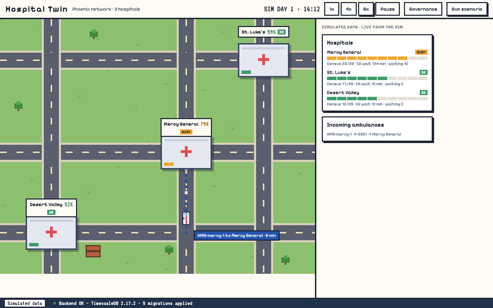
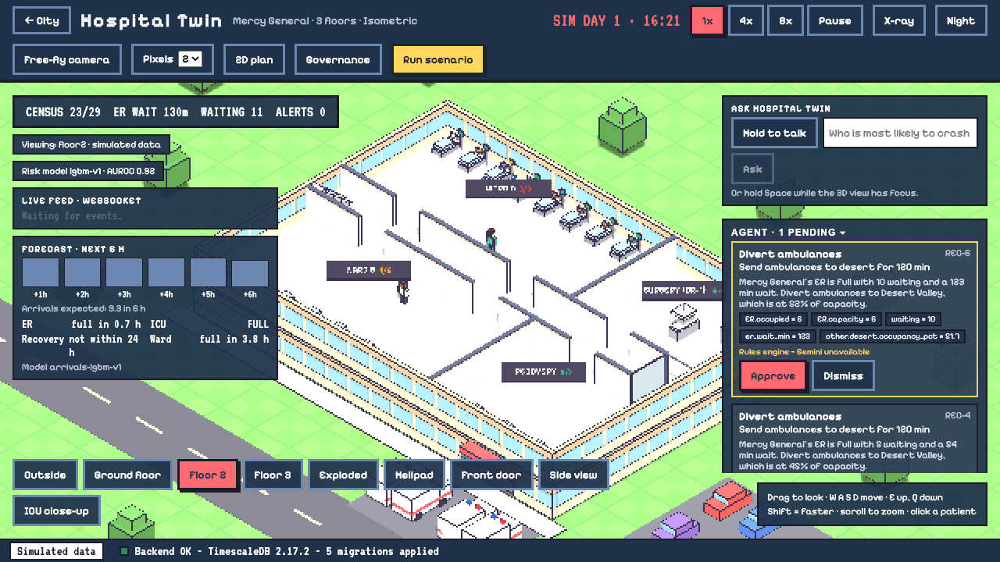
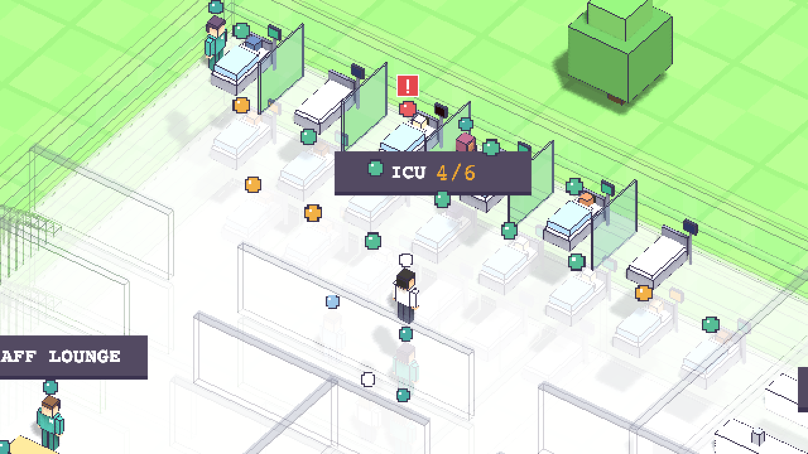
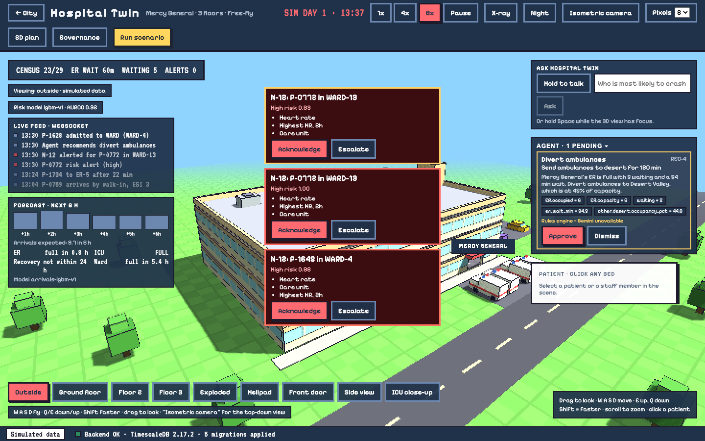
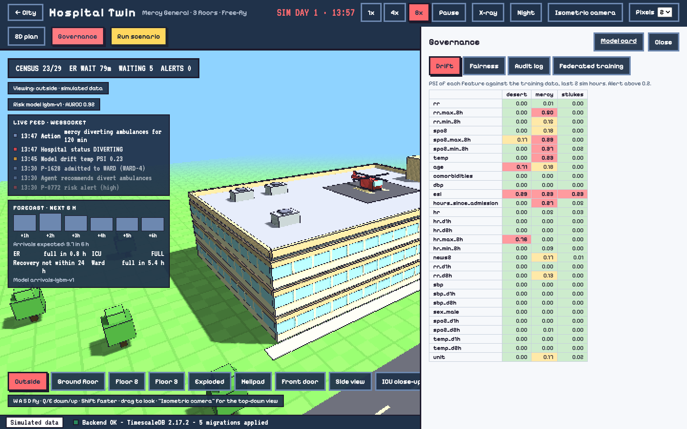
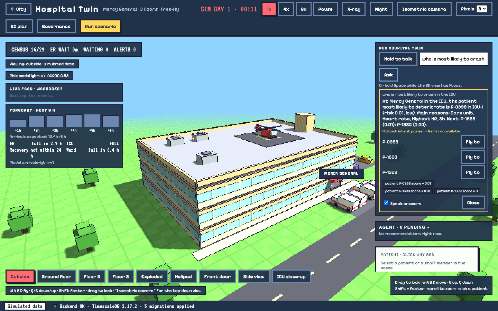
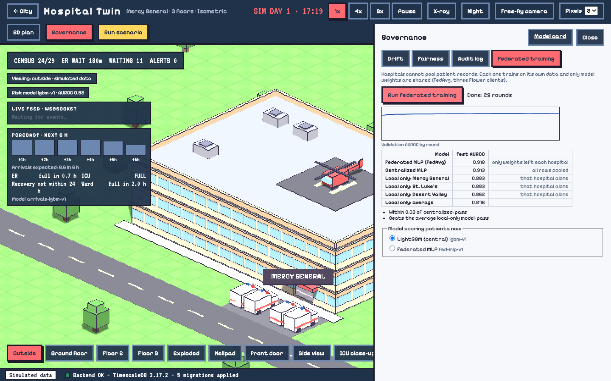

# Hospital Twin

A live digital twin of a three-hospital network, built for sunhacks. A simulation generates patients,
staff, vitals and ambulance traffic; the data lands in Tiger Data (TimescaleDB); ML models score every
patient; a Gemini agent recommends actions; and a pixel-art 3D hospital shows every patient, nurse and
doctor in real time.

All data is simulated. No real patient data is used anywhere.

The build spec is [PROMPT.md](PROMPT.md), the working rules are [CLAUDE.md](CLAUDE.md), and progress is
recorded checkpoint by checkpoint in [CHECKPOINTS.md](CHECKPOINTS.md).

## What it is



- **Network map:** the three hospitals with live status, ambulances on the roads, and the agent's diversions.
- **3D hospital:** a pixel-art, faceless-character building with every patient, nurse and doctor moving in real
  time. X-ray mode, floor presets, night mode, free-fly camera.
- **Risk models:** every patient is scored every 5 sim minutes (LightGBM with SHAP reasons), ER arrivals are
  forecast, length of stay is predicted, and a federated MLP can replace the central model.
- **Operations agent:** Gemini recommends diversions, discharges, staffing and bed holds with cited numbers; a
  rules engine takes over when Gemini is unavailable. Approving applies the action to the simulation.
- **Ask Hospital Twin:** hold the mic (or type) and ask "who is most likely to crash in the ICU?"; the answer is
  spoken and the patient is highlighted in 3D.
- **Governance:** drift heatmap, fairness table, audit log, model card, and federated vs centralized training.








Progress and evidence per checkpoint are in [CHECKPOINTS.md](CHECKPOINTS.md); the demo walkthrough is
[docs/demo_script.md](docs/demo_script.md); the deployment guide is [docs/deployment.md](docs/deployment.md).

## Setup on macOS

Tested on Apple Silicon (arm64).

1. Install the tools with Homebrew:

   ```sh
   brew install make jq uv openjdk@17 node@20
   ```

   `uv` downloads Python 3.12 for the project by itself. `openjdk@17` is used by Synthea (`make seed`).
2. Install [Docker Desktop](https://www.docker.com/products/docker-desktop/) and **start it** (click the
   Docker icon and wait until it says "running"). The database runs in Docker.
3. Install everything else:

   ```sh
   make setup
   ```

   This installs backend and frontend dependencies, downloads the Chromium build used by the end-to-end
   tests, pulls the TimescaleDB image, and creates `.env` from `.env.example` if you do not have one.
4. Start the app:

   ```sh
   make dev
   ```

   Open http://127.0.0.1:5173. The page shows the backend and database status read live from the API.
   Press Ctrl-C to stop the backend and frontend. `make db-down` stops the database.
5. Load the patients (once):

   ```sh
   make seed
   ```

   This downloads the Synthea 3.3.0 jar (183 MB, checksum verified), generates 3,000 living patients for
   Phoenix, Arizona with a fixed seed (about 2 minutes, 3.8 GB in `data/synthea/`, not committed) and loads
   them. Running it again reuses the generated files and takes about 15 seconds.

Ports used on your machine: 5173 (frontend), 8000 (backend), 5433 (development database),
5434 (test database).

## Commands

| Command | What it does |
| --- | --- |
| `make setup` | Install backend + frontend deps, pull Docker images, copy `.env.example` → `.env` if missing |
| `make db` | Start TimescaleDB (Docker), run migrations, copy the building from `shared/layout.json` into the reference tables |
| `make seed` | Generate Synthea patients and load them; prints the number loaded |
| `make train` | Simulate 30 days headless, train and evaluate the deterioration, arrivals and length-of-stay models, write the model card |
| `make fed-train` | Federated training across the three hospitals (needs `make train` first) |
| `make dev` | Run DB, backend and frontend dev server together |
| `make demo` | Start the stack and run the scripted demo scenario (see `docs/demo_script.md`) |
| `make record` | Perform the demo in a browser and record it to `docs/demo.webm` |
| `make test` | Unit + integration tests (integration tests use a real TimescaleDB in Docker) |
| `make e2e` | Playwright end-to-end tests against the running stack |
| `make verify` | Lint, type checks, all tests, coverage gates, skipped-test check, placeholder check |
| `make verify-live` | One real Gemini call on a live summary (needs `GEMINI_API_KEY` and `GEMINI_MODEL`) |
| `make seed-prod` | Load patients into the production (Tiger Cloud) database |
| `make deploy` | Build and deploy to the Vultr VM, migrate, smoke-check the public URL |
| `make smoke URL=https://...` | Smoke-check a running deployment |

## Repo layout

```
backend/        FastAPI app, simulation, DB access, ML, agent, governance (Python 3.12, uv)
frontend/       React + Vite + TypeScript, three.js 0.149.0
shared/         layout.json and ws_schema.json (generated)
infra/          docker-compose files, deploy files
docs/           evidence per checkpoint, model card, demo script
reference/      the 3D prototype, target renders and mockups made during the event
scripts/        checks used by make verify
```

## Configuration

Settings come from environment variables or `.env` (never committed). `.env.example` lists every
variable. Secrets are removed from log output.

## Prize tracks

### Tiger Data (TimescaleDB)

All time series live in hypertables: vitals, events, bed state, risk scores, forecasts, drift readings and the audit
log (`backend/twin/db/migrations/0003_hypertables.sql`). The dashboards and KPI endpoints read continuous aggregates
with real-time aggregation (`0004_continuous_aggregates.sql`), and vitals older than a day are compressed by a
policy (`0005_compression.sql`). The simulation writes in batches through `backend/twin/db/sim_writer.py`; the API
reads through `backend/twin/api/routes_*.py`. Production uses a Tiger Cloud service through `DATABASE_URL`.

### Gemini API

The operations agent asks Gemini for structured output (`backend/twin/agent/llm.py`, schema in `schema.py`), checks
every cited number against the data it was given (`validator.py`), retries once with the errors, and falls back to a
labelled rules engine (`rules.py`). "Ask Hospital Twin" uses Gemini function calling over six read-only tools
(`ask_llm.py`, `tools.py`) with the same grounding idea (`grounding.py`) and a deterministic intent parser fallback
(`intents.py`). The model name comes from `GEMINI_MODEL`; nothing is hardcoded. `make verify-live` makes one real
call.

### Vultr

Production runs on a Vultr VM: `infra/docker-compose.prod.yml` (backend container and Caddy),
`infra/backend.Dockerfile`, `infra/caddy.Dockerfile`, and `scripts/deploy.sh` (`make deploy`). Setup steps are in
[docs/deployment.md](docs/deployment.md).

### GoDaddy Registry

The site is served on a registered domain over automatic HTTPS: the A record points at the Vultr VM and Caddy
(`infra/Caddyfile`) obtains and renews the certificate for `DOMAIN`. `make smoke` checks the public URL.

## Team

Waleed Alfar (@waleedalfar).
